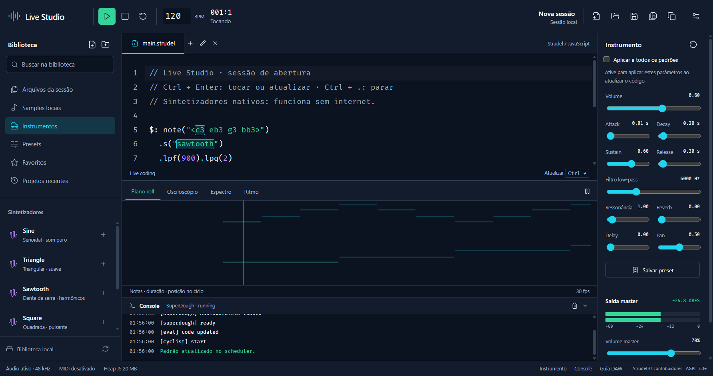

<div align="center">
  
  <h1>Live Studio</h1>
  <p><strong>Escreva padrões. Toque ao vivo. Conecte seu estúdio.</strong></p>
  <p>Um aplicativo desktop para Windows que reúne o motor Strudel,<br>projetos locais e ferramentas de produção musical em uma única janela.</p>
  <p>
    
    
    
    
  </p>
  <p><a href="https://github.com/pjz3650/strudel-based-studio/releases">Downloads</a> · <a href="docs/GUIA.md">Guia de uso</a> · <a href="docs/DESENVOLVIMENTO.md">Desenvolvimento</a> · <a href="docs/CONFORMIDADE.md">Estado dos requisitos</a></p>
</div>



## Um espaço para fazer música com código

O editor continua sendo o instrumento principal. Escreva mini-notation, combine camadas com `$:` e atualize os padrões enquanto a música toca. O Live Studio usa os pacotes oficiais do Strudel e seu scheduler original.

| Composição | Produção | Conexões |
|---|---|---|
| Editor CodeMirror com sintaxe, autocomplete e histórico por aba | Projetos `.live.json`, salvamento atômico e recuperação | Entrada MIDI, saída pelo scheduler e MIDI Learn |
| Mini-notation, transformações, polirritmia e efeitos | Samples locais, pré-escuta, categorias e favoritos | Seleção da saída de áudio quando suportada |
| Piano roll e visualização rítmica de eventos reais | Presets, envelope, filtro, reverb, delay e pan | Guias de loopMIDI, VB-CABLE e DAWs |
| Osciloscópio, FFT e medidores de pico estéreo | Temas claro/escuro e painéis ajustáveis | Aplicativo independente com instalador e portátil |

**O funcionamento básico é offline:** interface, fontes, AudioWorklets, sintetizadores, edição, reprodução, projetos e samples locais vêm no aplicativo ou são escolhidos no computador. A sessão inicial usa síntese nativa e não baixa bancos de sons. Os badges deste README são imagens externas; o aplicativo não os utiliza.

## Instalar

Baixe o instalador **NSIS** ou a versão **portátil** na [página de versões](https://github.com/pjz3650/strudel-based-studio/releases).

- **NSIS:** escolha a pasta de instalação e crie atalhos no menu Iniciar e na área de trabalho.
- **Portátil:** execute o `.exe`. Preferências e recuperação continuam no diretório de dados do usuário do Windows.
- Os pacotes não têm assinatura digital. O Windows SmartScreen pode mostrar um aviso de editor desconhecido. Verifique a origem e o SHA-256 publicado junto aos arquivos.

Não é necessário instalar Node.js, loopMIDI ou VB-CABLE para usar o motor musical básico.

## Sua primeira sessão

1. Abra o Live Studio e clique em **Tocar**, ou pressione **Ctrl + Enter**.
2. Edite o código e use o mesmo atalho para atualizar sem interromper o padrão válido.
3. Use **Ctrl + .** para parar e **Ctrl + S** para salvar.
4. Importe seus sons pela biblioteca e clique no nome de um sample para inserir seu identificador no editor.

```javascript
// Dois padrões simultâneos, sem samples externos.
$: note("<c3 eb3 g3 bb3>")
  .s("sawtooth")
  .lpf(900).lpq(2)
  .attack(0.02).release(0.35)
  .gain(0.25)

$: note("c5 eb5 g5 bb5 g5 eb5")
  .s("triangle").slow(2)
  .delay(0.25).room(0.3)
  .gain(0.24)
```

A aba ativa é executada. Outras abas são arquivos do projeto, sem reprodução simultânea automática. Para camadas, use `$:` ou `stack(...)` na mesma aba. Código inválido gera diagnóstico e mantém o último padrão válido; o botão de recuperação restaura o código anterior.

## Rodar pelo código-fonte

Requisitos: **Windows x64**, **Node.js 22+** e **pnpm 10.15.0**. No primeiro setup, habilite o pnpm com Corepack, se disponível, ou instale essa versão pelo método oficial.

```powershell
git clone https://github.com/pjz3650/strudel-based-studio.git
cd strudel-based-studio
pnpm install --frozen-lockfile
pnpm dev
```

| Comando | Resultado |
|---|---|
| `pnpm dev` | Electron com Vite apenas no desenvolvimento |
| `pnpm build` | TypeScript, interface e processos Electron em `dist/` |
| `pnpm start` | Abre o build local, sem servidor |
| `pnpm check` | Verificação de tipos e testes unitários |
| `pnpm test:e2e` | Testes de interface Electron; execute `pnpm build` antes |
| `pnpm pack` | Aplicativo extraído em `release/win-unpacked/` |
| `pnpm dist` | Instalador NSIS e executável portátil em `release/` |

## Arquitetura

```text
electron/        janela, menus, IPC validado, persistência e biblioteca
src/engine/     integração com REPL, Cyclist e SuperDough oficiais
src/shared/     schemas, formato de projeto e exemplos iniciais
src/ui/         editor, transporte, biblioteca, instrumentos e configurações
src/midi/       dispositivos, mensagens, MIDI Learn e mapeamentos
src/visuals/    piano roll, sinal, FFT, ritmo e medidores reais
src/styles/     tokens centralizados e layout
scripts/        desenvolvimento, build, worklets e recursos Windows
tests/          testes unitários e fluxos Electron com Playwright
docs/           guias, diagnóstico, evidências e matriz de requisitos
```

O renderer não recebe Node.js nem acesso genérico ao sistema de arquivos. O preload expõe operações específicas, validadas no processo principal. Samples escolhidos são servidos pelo protocolo local `studio://sample/...`. Nenhum servidor de desenvolvimento acompanha a versão empacotada. Veja a [arquitetura e o modelo de segurança](docs/ARQUITETURA.md).

## Branches por feature

O trabalho foi organizado em branches encadeadas, sem o prefixo `codex`:

| Branch | Escopo |
|---|---|
| `desktop/foundation` | Base Electron, bridge, schemas e persistência |
| `features/projects-library` | Sessões, editor, biblioteca e instrumentos |
| `features/studio-interface` | Workspace, transporte, temas e configurações |
| `features/midi-visuals` | MIDI, piano roll e análise do áudio |
| `quality/packaging-docs` | Integração, correções, testes, empacotamento e documentação |
| `main` | Entrega integrada |

As branches registram etapas dependentes. Use `main` para compilar a aplicação completa.

## Validação e limites

Foram executados **1.093 testes do upstream**, **28 testes unitários próprios** e **cinco fluxos Electron** que verificam áudio offline, atualização ao vivo, erro recuperável, arquivos locais, salvamento, recuperação, MIDI sem hardware e responsividade. A revisão independente confirmou a resolução dos quatro ajustes encontrados. Os comandos e resultados completos estão em [VALIDACAO.md](docs/VALIDACAO.md).

O projeto está em **versão inicial 0.1.0**. Ainda existem requisitos parciais: validação física com controladores, loopMIDI e DAWs; testes de roteamento VB-CABLE; validação completa de MP3/OGG e recursos opcionais da extensa API Strudel. Não há VST, ASIO nativo, gravação/exportação de áudio dentro do app ou medição LUFS. A [matriz de conformidade](docs/CONFORMIDADE.md) discrimina implementação e evidência sem equiparar código a validação.

## Documentação

- [Guia de uso, áudio, MIDI e solução de problemas](docs/GUIA.md)
- [Arquitetura, segurança e persistência](docs/ARQUITETURA.md)
- [Desenvolvimento, testes e empacotamento](docs/DESENVOLVIMENTO.md)
- [Formato versionado dos projetos](docs/PROJETOS.md)
- [Diagnóstico do Strudel original](docs/DIAGNOSTICO.md)
- [Evidências de validação](docs/VALIDACAO.md)
- [Matriz de requisitos e limitações](docs/CONFORMIDADE.md)
- [Sistema visual e tokens](DESIGN.md)

## Licença e reconhecimento

**AGPL-3.0-or-later.** Consulte [LICENSE](LICENSE) e [avisos de terceiros](THIRD_PARTY_NOTICES.md). A licença MIT inicial foi preservada em [LICENSE.initial-MIT](LICENSE.initial-MIT).

O motor musical é o [Strudel](https://codeberg.org/uzu/strudel), © seus contribuidores, incluindo Alex McLean e Felix Roos. O Live Studio é um projeto independente e não é afiliado ao Strudel. Não distribui bancos de samples de terceiros; cada sample importado mantém sua licença original.

O monorepo oficial foi consultado localmente, sem alterações ou contribuições enviadas ao upstream. Este repositório publica o shell independente e depende das versões oficiais dos pacotes, fixadas em `pnpm-lock.yaml`. O código-fonte correspondente desta aplicação está disponível neste repositório.
