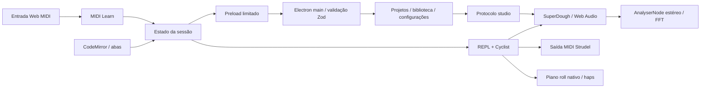

# Arquitetura

O Live Studio separa o sistema operacional do motor e da interface. Não altera o scheduler nem o código interno dos pacotes Strudel.

## Processo principal

`electron/main.ts` cria a janela, define menus, registra o protocolo e verifica origem e frame de cada mensagem IPC. `library.ts` mantém o catálogo, resolve caminhos aprovados e processa importações sem ler todos os arquivos para a memória. `storage.ts` serializa gravações por destino, escreve um arquivo temporário no mesmo volume, sincroniza e renomeia.

Os diálogos nativos concedem acesso a projetos e samples. O renderer passa IDs de projetos recentes; não pode enviar um caminho arbitrário para leitura/gravação. Apenas o projeto atualmente aberto pode ser salvo diretamente; Salvar como exige seleção pelo diálogo. Criar/duplicar libera a associação anterior para evitar sobrescrever o projeto de origem.

## Renderer e motor

`StudioState` reúne projeto, preferências, catálogo e logs limitados a 200 entradas. Alterações agendam recuperação após 700 ms. O editor mantém `EditorState` independente por arquivo, incluindo histórico próprio. A execução usa a aba ativa e recebe callbacks do REPL para erro/atualização.

As versões publicadas usam `defaultOutput`/`onTrigger`, enquanto o HEAD oficial já usa `onSchedule`. Por isso a integração utiliza `webaudioRepl` da versão fixada. A composição emprega `@strudel/core`, `mini`, `tonal`, `transpiler`, `webaudio`, `draw` e `midi`, compartilhando a mesma instância de `Pattern`. O bundle `@strudel/web` foi evitado porque incorpora outra cópia do motor.

Controles globais de instrumento são transformações do padrão por `editPattern`. Quando desativados, os parâmetros escritos no código são preservados. O volume master atua no `GainNode` de saída. O tempo é convertido de BPM em ciclos/segundo por `bpm/240`, seguindo quatro batidas por ciclo. Código pode usar `setcpm` e estabelecer seu próprio tempo; o campo de BPM volta a ser aplicado na próxima avaliação.

## Áudio e visualizações

Piano roll reutiliza `__pianoroll` de `@strudel/draw` e haps consultados no padrão do scheduler. Ritmo e realce de mini-notation também usam eventos reais. O loop visual usa requestAnimationFrame com limitação configurável e não agenda notas.

Um tap do master alimenta o analisador e um splitter de dois canais. Os nós de análise não são conectados de volta à saída. Os medidores calculam máximo absoluto das amostras e `20*log10(peak)`; são picos de amostra, não true peak, RMS ou LUFS. Recursos e loops são descartados ao encerrar. O heap mostrado é memória JavaScript do renderer, não RAM total nem CPU.

Os AudioWorklets originalmente embutidos em URLs data são extraídos pelo plugin `scripts/worklets.mjs` para arquivos locais com hash durante o build. Isso conserva a CSP sem permitir scripts remotos ou data scripts. O desenvolvimento serve os mesmos módulos por middleware local.

## MIDI

O pacote MIDI oficial fornece `.midi(...)` ligado ao scheduler. A seleção global aplica a porta e o canal ao padrão; portas por padrão continuam possíveis deixando a seleção global vazia. Entrada, Learn e testes manuais usam Web MIDI. Não existe timer paralelo para a reprodução musical MIDI.

O código rastreia estado das portas e mantém o nome escolhido. Se a porta for removida/renomeada, informa indisponibilidade, sem trocar silenciosamente por outra. Ao parar, limpa filas disponíveis e envia All Notes Off e All Sound Off em todos os canais das portas acessíveis. Mapeamentos guardam nome de entrada, canal, CC e destino.

## Segurança

- `contextIsolation:true`, `nodeIntegration:false`, `sandbox:true`, `webSecurity:true`.
- Preload com métodos específicos; sem shell, eval Node, leitura de diretório genérica ou caminhos arbitrários no renderer.
- Validação Zod em IPC, restrição ao frame principal e ao documento da aplicação.
- Navegação externa bloqueada; abertura no navegador apenas para três URLs documentais fixadas.
- Permissões limitadas a MIDI e seleção de saída, para a janela confiável. Não solicita microfone ou câmera.
- Protocolo de samples aceita somente UUIDs de recursos registrados; verifica realpath, extensão, tipo e tamanho. Pastas importadas ignoram symlinks e limitam profundidade e quantidade.
- A CSP permite `unsafe-eval` para o compilador Strudel, estilos inline do CodeMirror e worklets locais. Não autoriza scripts externos. A origem loopback está presente para desenvolvimento, mas não fornece arquivos do produto em produção.

Código musical é JavaScript executado no renderer: só execute código em que confia. O isolamento Electron protege o Node/sistema operacional, mas não transforma JavaScript arbitrário em uma linguagem sem acesso à interface, aos dados já abertos ou sem possibilidade de travar a thread. Projetos não são executados automaticamente ao abrir.

## Dados no Windows

O diretório é `app.getPath('userData')`, normalmente `%APPDATA%/live-studio`, independente da pasta de instalação. Ele contém `settings.json`, `window.json`, `recent.json`, `library.json` e `recovery.json`. Projetos são salvos onde o usuário escolher. Dados inválidos são copiados com sufixo `.corrupt-<timestamp>` antes de restaurar padrões.

Samples ficam em seus caminhos originais. O catálogo guarda IDs, metadados e referências aprovadas; o renderer não recebe os caminhos completos. Reassociar gera uma revisão de URL para evitar reutilizar o buffer do arquivo anterior. O cache do SuperDough é sob demanda e permanece até reiniciar; ainda não há política LRU ou teto agregado de cache.
